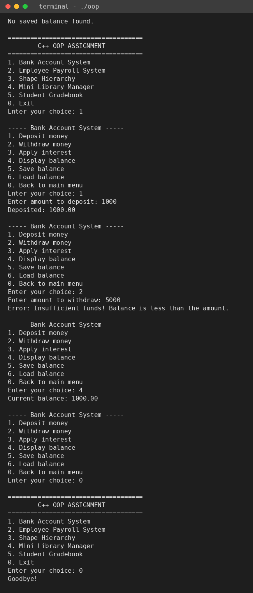
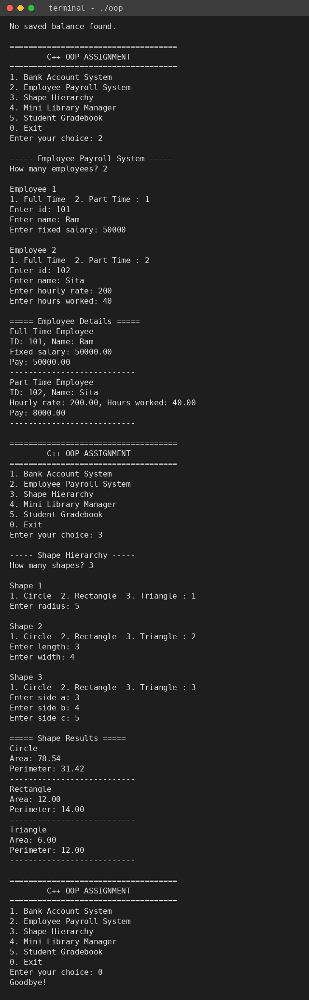

# Bank Account OOPS

## What it does
A console-based C++ program with five mini projects (bank account, payroll, shapes, library, gradebook) that shows the main OOP concepts, all run from one main menu.

## Features
- Bank Account System: deposit, withdraw, apply interest, save and load balance from a file
- Employee Payroll System: full-time and part-time pay using polymorphism
- Shape Hierarchy: area and perimeter of circle, rectangle and triangle
- Mini Library Manager: add, remove and search books, save and load from a text file
- Student Gradebook: marks, total, average and grade

## Tech used
C++ | g++ | iostream | fstream | vector | map | cmath | iomanip

## OOP concepts shown
- Classes and objects
- Encapsulation
- Inheritance (SavingsAccount, FullTimeEmployee, PartTimeEmployee, Circle, Rectangle, Triangle)
- Virtual functions and runtime polymorphism (Employee and Shape)
- Exception handling (try, throw, catch for InsufficientFunds)
- File handling with fstream
- STL (vector and map)

## Requirements
See `requirements.txt`. You only need a C++ compiler like g++. No libraries to install.

## How to run
```bash
git clone https://github.com/Arya-Rajvansh/Bank-Account-OOPS.git
cd Bank-Account-OOPS
g++ main.cpp -o oop
./oop
```
On Windows, run `oop.exe` instead of `./oop`.

## Screenshot



## What I learned
- Using inheritance, virtual functions and base class pointers for runtime polymorphism
- Handling errors with try, throw and catch
- Saving and loading data with fstream
- Using vector and map from the STL

## Status
✅ Complete
